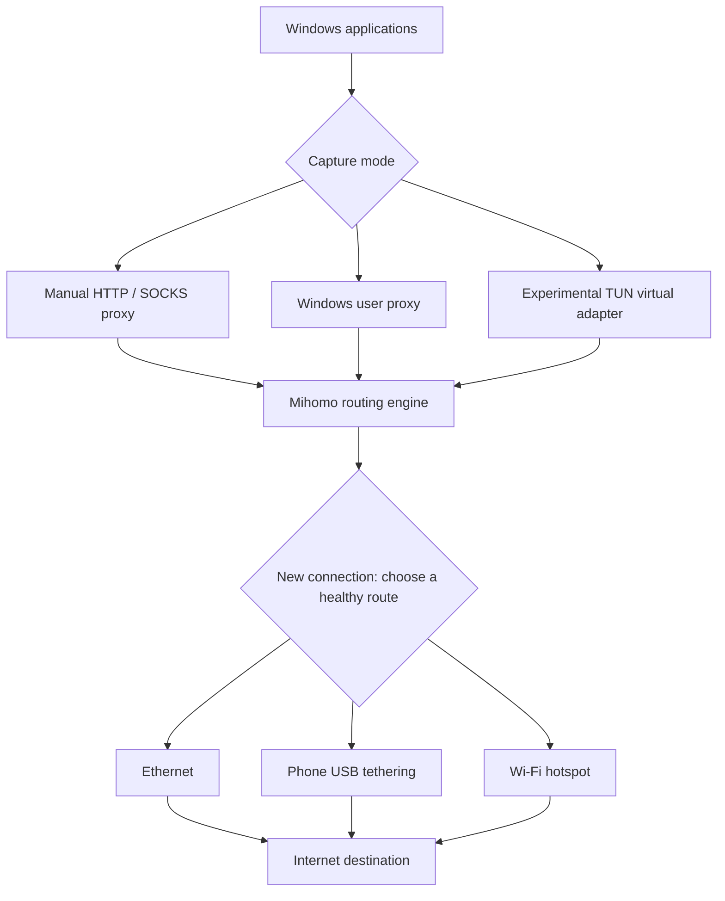

# NetworkHub

A Windows desktop app that shares **separate connections** across Ethernet, USB tethering, and Wi-Fi. Built with Python/Tk and the Mihomo routing engine. Licensed under GPL-3.0-only.

**Experimental, IPv4 only. This is connection load balancing, not single-stream bandwidth bonding.** No VPS is needed. A remote aggregation endpoint is needed to combine multiple networks for one connection. NetworkHub does not implement that feature.

## What it does

- Detects active network adapters with IPv4 default gateways.
- Lets you select networks and see their receive activity.
- Distributes new connections using round-robin balancing among healthy routes.
- Shows connections, destinations, route names, and received bytes reported by Mihomo.
- Offers manual HTTP/SOCKS, Windows user proxy, and experimental administrator TUN modes.
- Restores the Windows proxy settings it manages when you stop routing or close normally.

Routing starts off. Manual proxy is the default mode. Independent internet subscriptions are needed for independent capacity: two devices sharing the same upstream connection still share that upstream bottleneck. Adapter counters include traffic from other software and do not measure only NetworkHub's throughput.

## Run from source

Requirements: Windows 10/11 x64, Python 3.12 with Tk, and a CPU supporting the **x86-64-v3** instruction set (the pinned engine build requires this; AVX2 alone is not the complete requirement). No administrator access is required for manual proxy mode.

In PowerShell, from this repository:

```powershell
py -3.12 -m venv .venv
.\.venv\Scripts\python.exe -m pip install -r requirements.txt
.\.venv\Scripts\python.exe scripts\fetch_engine.py
.\.venv\Scripts\python.exe src\network_hub.py
```

The fetch script downloads pinned Mihomo and official Wintun archives over HTTPS and checks their SHA-256 hashes before extracting the required files. See [THIRD_PARTY.md](THIRD_PARTY.md).

Select your connected networks and choose a mode:

| Mode | How apps use it | Administrator access |
| --- | --- | --- |
| Manual HTTP / SOCKS proxy | Set an app's proxy to `127.0.0.1:10890` | No |
| Browsers and proxy-aware apps | Uses your current Windows user's proxy setting; apps must respect it | No |
| All-app mode | A virtual TUN adapter captures compatible IPv4 traffic | Windows UAC approval |

All-app mode is experimental. It has passed configuration validation but has **not been tested live**. Applications using their own VPN, special routes, or IPv6 may bypass it. Switching modes can interrupt connections; apps may need to reconnect. Private and local-network destinations remain direct. This app is not an encrypted privacy VPN.

## How it works



`network_routes.py` reads adapter names, interface indices, and IPv4 addresses through PowerShell. `network_engine.py` creates one Mihomo direct outbound per selected adapter, binds it using `interface-name`, and puts the outbounds into a round-robin load-balance group. A health check tests each route every 30 seconds. Existing transfers are not stitched together or seamlessly migrated between public IPs.

`network_hub.py` provides the Tk interface. It samples adapter counters with psutil, queries the authenticated loopback controller for active connections, and starts or stops routing in a background thread. The controller listens only on `127.0.0.1:19090`, the proxy on `127.0.0.1:10890`, and DNS on `127.0.0.1:11053`.

For example, with a 30 Mbps Ethernet connection and a 20 Mbps phone connection, one transfer still uses one route. Several transfers may together approach their combined capacity, subject to server limits, latency, congestion, and routing choices. A segmented downloader may benefit because it opens multiple connections. There is no guaranteed speed increase for every app.

Implementation references: [Mihomo direct outbounds](https://wiki.metacubex.one/en/config/proxies/direct/), [load balancing](https://wiki.metacubex.one/en/config/proxy-groups/load-balance/), [TUN configuration](https://wiki.metacubex.one/en/config/inbound/tun/).

## Build a Windows application

```powershell
.\.venv\Scripts\python.exe -m pip install -r requirements-build.txt
# Activate the venv, or place its Scripts directory first on PATH for build.ps1.
.\.venv\Scripts\Activate.ps1
.\scripts\build.ps1
```

The app is produced at `dist\NetworkHub\NetworkHub.exe`. Distribute the **whole folder**, including `_internal`, `bin`, source, and license notices. The executable is unsigned. This repository's CI runs Windows tests and syntax checks; it does not publish binary releases automatically.

## Settings, logs, and recovery

Runtime files are stored in `%LOCALAPPDATA%\NetworkHub`, never in the repository. `NETWORKHUB_DATA_DIR` can override that directory. It must be the same when restarting elevated. The original PC-specific model-download integration is excluded from this public version.

Use **Stop routing** or **Recover networking** before closing. If the app crashes while browser mode is enabled, reopen it and choose Recover networking. If TUN mode remains active, reopen as administrator and choose Recover networking. If needed, Windows Settings → Network & internet → Proxy can be used to turn off NetworkHub's manual proxy at `127.0.0.1:10890`; restore your previous organization/PAC settings if applicable. Do not remove recovery files before recovering.

Logs can contain destination hosts and process names. The controller token and configuration contain a local API secret. Do not share your runtime folder. No analytics or remote control service is included in NetworkHub. The routing core makes route-health and DNS requests to the configured external providers.

## Validation and contributing

```powershell
.\.venv\Scripts\python.exe -m unittest discover -s tests -v
.\.venv\Scripts\python.exe src\network_hub.py --self-test
```

Unit tests cover adapter-bound routing configuration, controller exposure, and Windows proxy backup/restoration using an isolated test registry key. The initial PC-specific build additionally passed nine concurrent 1 MiB HTTPS proxy transfers with all three adapter routes observed. The public version's live validation is documented in [VALIDATION.md](VALIDATION.md). TUN routing, IPv6, and long-running recovery need further testing before production use.

Contributions are welcome through issues and pull requests. Describe your Windows version, mode, adapter types, and reproducible steps; redact tokens, IPs, hosts, and process details from logs. Please discuss IPv6 support, bonding, or new routing strategies before large changes. New source contributions are GPL-3.0-only.
